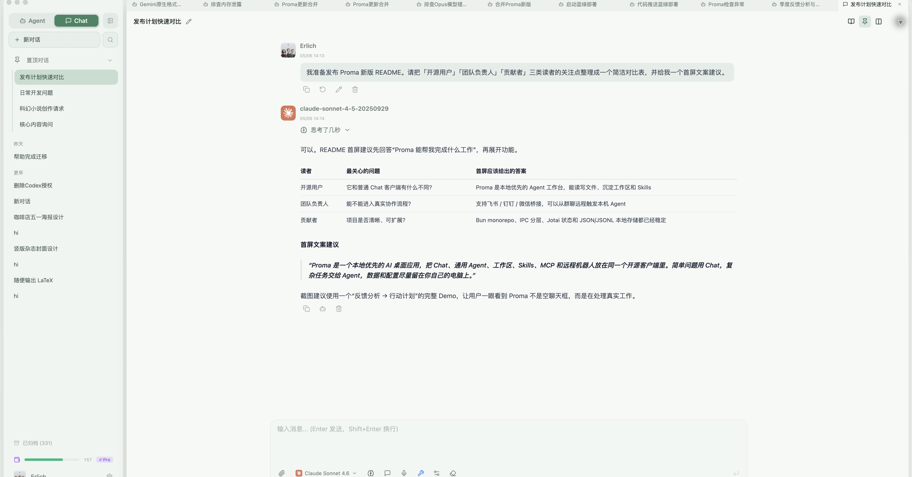
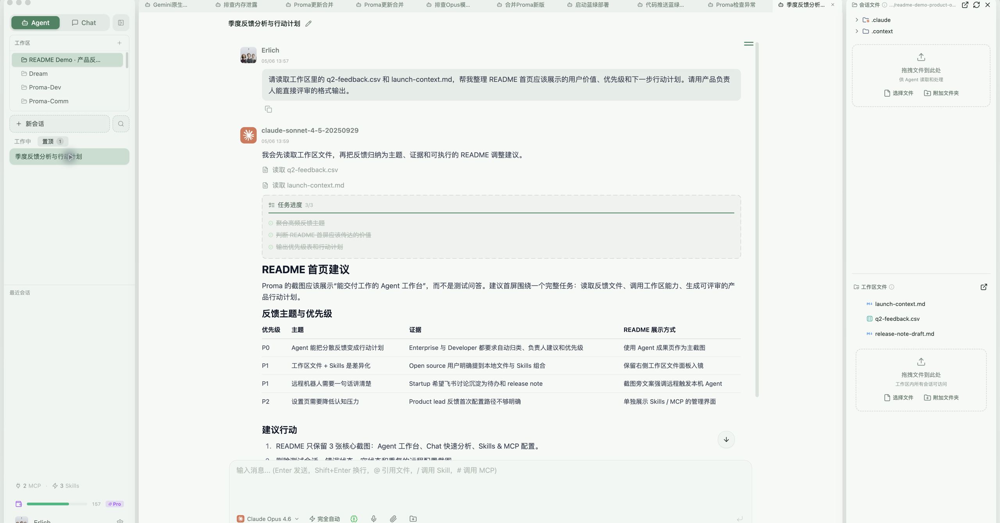
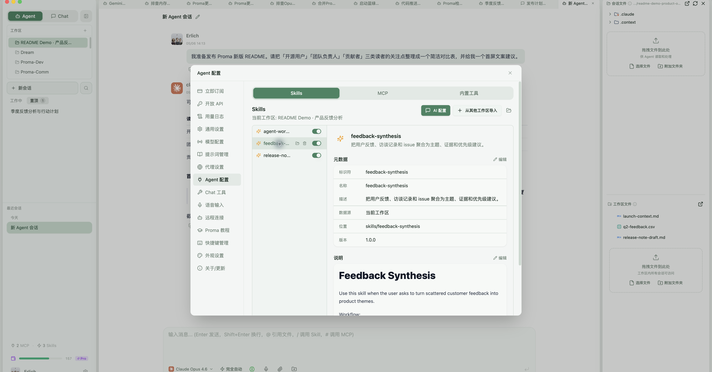
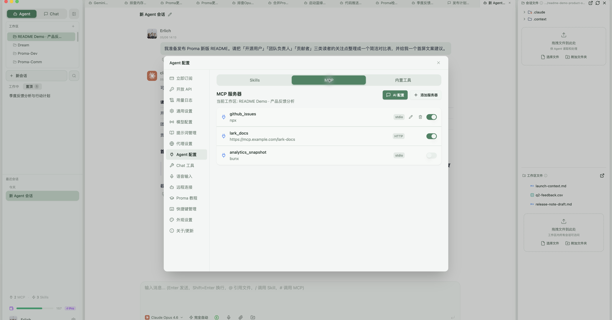
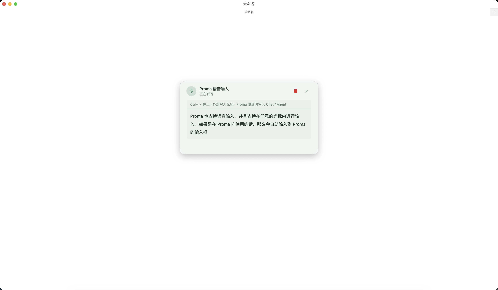

# MAPro

MAPro 是一个本地优先的 AI 桌面应用，把多模型 Chat、通用 Agent、工作区、Skills、MCP、远程机器人和记忆能力放在同一个开源客户端里。

它不是只面向闲聊的聊天框，而是一个可以长期沉淀个人工作流的 Agent 工作台：简单问题用 Chat，复杂任务交给 Agent，数据和配置尽量留在本地。


<video width="560" controls>
  <source src="https://img.erlich.fun/personal-blog/uPic/%E7%AE%80%E5%8D%95%E4%BB%8B%E7%BB%8D%20Proma.mp4" type="video/mp4">
</video>

[English README](./README.en.md) | [新手教程](./tutorial/tutorial.md) | [下载开源版](https://github.com/andrewchay/mapro/releases)

## 现在能做什么

- **Chat 模式**：多模型对话、附件解析、图片输入、Markdown / Mermaid / KaTeX / 代码高亮、并排对话、系统提示词、上下文管理。
- **Agent 模式**：基于 `@anthropic-ai/claude-agent-sdk` 的通用 Agent，支持工作区隔离、权限模式、文件操作、长任务流式输出、计划确认和用户追问。
- **Campaign 项目管理（Web & 桌面端）**：KOL 投放项目、13 步标准工作流、产物校验、KOL 候选池、达人 Brief 生成、AI 内容审核、内容数据追踪与投流分析。
- **SubAgent / Tasks**：复杂任务可以通过 Claude Agent SDK 的 Agent 工具拆分为子 Agent / Task，并在消息流中展示调用过程和结果。
- **Skills & MCP**：每个工作区可以独立配置 Skills、MCP Server 和工作区文件，适合沉淀可复用能力。
- **远程机器人**：支持飞书 / Lark 机器人桥接，并已提供钉钉、微信桥接入口，用手机或群聊触发本机 Agent 工作流。
- **记忆与工具**：Chat 和 Agent 可共享记忆能力，并支持联网搜索、内置 Chat 工具、Agent 推荐等辅助能力。
- **本地优先**：会话、工作区、附件、配置、Skills 等默认存储在 `~/.mapro/`，使用 JSON / JSONL 文件组织；Campaign / KOL 等需要关系查询的业务数据使用 SQLite。
- **桌面体验**：自动更新、代理设置、文件预览、全局快捷键、快速任务窗口、语音输入、亮色 / 暗色 / 跟随系统主题。

## 快速开始

### 下载安装

从 [GitHub Releases](https://github.com/andrewchay/mapro/releases) 下载开源版本。当前版本为 `v0.1.9`，提供 macOS Apple Silicon、macOS Intel 和 Windows 安装包。

### 首次配置

1. 打开 MAPro，先完成环境检查。Agent 模式依赖本机基础环境，尤其是 Git、Node.js / Bun 以及可用的 Shell。
2. 进入 **设置 > 渠道**，添加至少一个 AI 供应商渠道，填写 Base URL、API Key 和模型列表。
3. Chat 模式可以使用 OpenAI、Anthropic、Google 或 OpenAI 兼容协议的渠道。
4. Agent 模式需要 Anthropic 协议或 Anthropic 兼容协议渠道，例如 Anthropic、DeepSeek、Kimi API、Kimi Coding Plan。
5. 进入 **设置 > Agent**，选择默认 Agent 渠道、模型和工作区。
6. 如需记忆、联网搜索、飞书 / 钉钉 / 微信桥接，在设置页对应 Tab 中继续配置。

## 模式选择

### Chat 适合

- 日常问答、解释、翻译、润色、轻量代码讨论。
- 读取附件内容后做总结、改写、比较。
- 使用联网搜索或记忆工具增强一次性对话。
- 同时对比多个模型输出，或用不同系统提示词做探索。

### Agent 适合

- 修改、创建、整理本地文件。
- 调研、编写报告、处理多步骤任务。
- 使用 MCP、Skills、Shell、Git、项目文件等外部上下文。
- 需要权限确认、计划模式、后台任务或远程机器人持续跟进的工作。

简单说：**只需要回答时用 Chat，需要行动和交付结果时用 Agent。**

## 截图

### Chat 快速分析

用 Chat 处理轻量但真实的分析任务：整理读者关注点、生成对比表，并把首屏文案快速定稿。



### Agent 工作台

Agent 在工作区里读取文件、推进任务、输出表格化结论，并把可复用文件保留在右侧工作区面板中。



### Skills

每个工作区都可以沉淀专属 Skills。截图中的 `feedback-synthesis` 用于把用户反馈、访谈记录和 issue 聚合成主题、证据与优先级建议。



### Skills & MCP

同一个工作区可以管理 stdio / HTTP MCP Server，按需启用或关闭，让 Agent 在不同项目里获得不同的外部上下文。



### 流式语音输入(支持全局输入)
MAPro 支持豆包的流式语音输入功能，并且支持在 MAPro 内使用和 MAPro 外部使用：
- MAPro 内部使用：Ctrl + ` 触发识别，再次按下结束自动输入到 MAPro 内对应的输入框
- MAPro 外部使用：Ctrl + ` 触发识别，再次按下结束自动输入到当前的光标所在处，如无光标则默认写入到剪贴板
- 


## 支持的模型渠道

| 供应商 | Chat | Agent | 协议说明 |
| --- | --- | --- | --- |
| Anthropic | 支持 | 支持 | Anthropic Messages API |
| DeepSeek | 支持 | 支持 | Anthropic 兼容协议 |
| Kimi API | 支持 | 支持 | Anthropic 兼容协议 |
| Kimi Coding Plan | 支持 | 支持 | Anthropic 兼容协议，使用专用认证头 |
| OpenAI | 支持 | 暂不支持 | Chat Completions |
| Google | 支持 | 暂不支持 | Gemini Generative Language API |
| 智谱 AI | 支持 | 支持 | Anthropic 兼容协议 |
| MiniMax | 支持 | 支持 | Anthropic 兼容协议 |
| 豆包 | 支持 | 支持 | Anthropic 兼容协议 |
| 通义千问 | 支持 | 支持 | Anthropic 兼容协议 |
| 自定义端点 | 支持 | 暂不支持 | OpenAI 兼容协议 |

Agent 模式底层使用 Claude Agent SDK，因此目前要求渠道提供 Anthropic 或 Anthropic 兼容协议。Chat 模式则通过 `@ma-proma/core` 的 Provider Adapter 统一接入不同协议。

## 本地数据

MAPro 采用本地文件存储，方便备份、迁移和排查问题。

```text
~/.mapro/
├── channels.json
├── conversations.json
├── conversations/
│   └── {conversation-id}.jsonl
├── agent-sessions.json
├── agent-sessions/
│   └── {session-id}.jsonl
├── agent-workspaces/
│   └── {workspace-slug}/
│       ├── workspace-files/
│       ├── mcp.json
│       └── skills/
├── campaign-database.sqlite  # Campaign / KOL 候选池 / Brief / 内容审核 / 内容追踪
├── kol-database.sqlite       # KOL 主数据库与评分系统
├── attachments/
├── user-profile.json
├── settings.json
└── sdk-config/
```

API Key 会通过 Electron `safeStorage` 加密后写入 `channels.json`。MAPro 不使用本地数据库，核心数据结构以 JSON 配置和 JSONL 追加日志为主。

## Web 端部署

MAPro 同时提供 Web 服务端入口（`apps/web`）和 Web SPA（`apps/web-ui`），适合在服务器或容器中单用户/小团队使用。Web 端与桌面端共享 `packages/server` 业务逻辑，通过 Express + WebSocket 暴露 REST API。

> 当前 Web 版定位：内部单用户/小团队 MVP。若需面向公网的 SaaS 级多租户部署，仍需额外完成认证授权、进程隔离、审计与资源限制等平台安全改造。

### 部署要求

- Docker + Docker Compose（推荐）
- 或本机安装 Bun 1.2.5+

### Docker 部署（推荐）

1. 克隆仓库：

```bash
git clone https://github.com/andrewchay/mapro.git
cd mapro
```

2. （可选）复制环境变量模板并按需修改：

```bash
cp .env.example .env
```

3. 启动服务：

```bash
docker compose up --build -d
```

4. 检查健康状态：

```bash
curl http://localhost:3000/health
```

预期返回示例：

```json
{ "status": "ok", "chatEnabled": true, "agentEnabled": false }
```

5. 停止服务：

```bash
docker compose down
```

### 环境变量

| 变量 | 必需 | 说明 |
| --- | --- | --- |
| `MAPRO_DATA_DIR` | 生产必填 | 数据根目录（SQLite/JSONL/工作区），Docker 默认 `/app/data` |
| `MAPRO_WEB_UI_DIR` | 生产必填 | 前端静态产物目录，Docker 默认 `/app/web-ui-dist` |
| `MAPRO_WEB_PORT` | 可选 | HTTP 端口，默认 `3000` |
| `MAPRO_WS_PORT` | 可选 | WebSocket 端口，默认 `8081` |
| `MAPRO_WEB_HOST` | 可选 | HTTP/WebSocket 监听地址，默认 `127.0.0.1` |
| `MAPRO_CHAT_PROVIDER` | 用 Chat 时必填 | 单 Provider，如 `deepseek` / `openai` / `anthropic` |
| `MAPRO_CHAT_API_KEY` | 用 Chat 时必填 | 对应 Provider 的 API Key |
| `MAPRO_CHAT_BASE_URL` | 可选 | 自定义端点 |
| `MAPRO_CHAT_MODEL` | 可选 | 模型名 |
| `MAPRO_AGENT_PROVIDER` | 用 Agent 时必填 | Agent 渠道 Provider |
| `MAPRO_AGENT_API_KEY` | 用 Agent 时必填 | Agent 渠道 API Key |
| `MAPRO_AGENT_BASE_URL` | 可选 | Agent 自定义端点 |
| `MAPRO_AGENT_MODEL` | 可选 | Agent 模型名 |
| `MAPRO_ENCRYPTION_KEY` | 推荐 | 服务端 AES-256-GCM 主密钥，未设置时使用默认密钥 |
| `MAPRO_API_TOKEN` | 推荐 | HTTP API 与 WebSocket 共享的 Bearer Token；未设置时仅允许本地 Origin |
| `MAPRO_MASTER_KEY` | 服务端必填 | `ServerSecretsStore` 主密钥，用于加密 channels.json 中的 API Key；未设置时回退明文（仅开发） |
| `MAPRO_JWT_SECRET` | 生产必填 | JWT access token 签名密钥；未设置时回退 `MAPRO_MASTER_KEY`（仅开发） |
| `MAPRO_JWT_ACCESS_TTL` | 可选 | Access token 有效期（秒），默认 `900` |
| `MAPRO_AUTH_DISABLED` | 可选 | 设为 `1` 时关闭 JWT，所有请求映射为 system 账号（仅本地开发） |
| `MAPRO_TRUST_PROXY` | 可选 | 设为 `1` 时启用 Express `trust proxy`，反向代理后可正确识别 `req.secure` |
| `MAPRO_ALLOWED_ORIGINS` | 可选 | 显式允许的 CORS Origin 列表，逗号分隔；设置 Token 后默认禁止跨域 |

最小可运行示例（仅 Chat）：

```bash
docker compose up --build -d \
  -e MAPRO_DATA_DIR=/app/data \
  -e MAPRO_CHAT_PROVIDER=deepseek \
  -e MAPRO_CHAT_API_KEY=sk-xxx \
  -e MAPRO_MASTER_KEY=your-master-key-at-least-16-chars
```

### 认证与安全约束

Web 版已内置基于 JWT + httpOnly refresh cookie 的多用户认证与 RBAC 授权。

- **Access Token**：仅存前端内存，通过 `Authorization: Bearer <token>` 访问 `/api/*`，默认有效期 15 分钟。
- **Refresh Token**：服务端生成后通过 `HttpOnly; SameSite=Strict; Secure（HTTPS 时）` cookie 返回，有效期 7 天；支持 rotation，每次刷新会吊销旧 token。
- **页面刷新**：前端启动时若内存无 access token，会先调用 `/auth/refresh`（依赖 cookie）恢复，再获取用户上下文，因此刷新页面不会掉登录。

**生产部署必须满足以下至少一项：**

- 将 `MAPRO_WEB_HOST` 保持为 `127.0.0.1`，仅本地访问；
- 或前置反向代理（nginx / Caddy / Traefik）加 HTTPS，并设置 `MAPRO_TRUST_PROXY=1`，使服务端正确识别 `req.secure`；
- 或设置 `MAPRO_API_TOKEN`，作为服务账号 Token 绕过 JWT 流程（仅推荐内部/自动化场景）。

**Token 行为：**

- `MAPRO_API_TOKEN` 同时保护 HTTP API（`Authorization: Bearer <token>`）与 WebSocket（`ws://host:port/?token=<token>`）。
- Web UI 由后端托管时会通过 `httpOnly; SameSite=Strict` Cookie 自动携带该 token，无需手动输入，也不会暴露在页面全局变量中；独立构建（CDN / Vercel）可通过 `VITE_API_TOKEN` 或 `localStorage.setItem('mapro-api-token', '<token>')` 提供。
- 未设置 Token 且未禁用认证时，CORS 仅允许 `localhost` / `127.0.0.1` Origin，WebSocket 也仅接受本地 Origin，降低恶意网页调用本机 API 的风险。
- 设置 Token 后，CORS 默认禁止跨域；如需第三方域名访问，请配置 `MAPRO_ALLOWED_ORIGINS`。
- 生产环境务必配置 `MAPRO_JWT_SECRET`（或复用强随机的 `MAPRO_MASTER_KEY`），并启用 HTTPS。

若启用 Agent，建议同时配置：

- `MAPRO_AGENT_DISABLED_TOOLS`：禁用危险工具或命令模式；
- `MAPRO_AGENT_CPU` / `MAPRO_AGENT_MEMORY` / `MAPRO_AGENT_NETWORK`：限制 Agent 容器/进程资源；
- Docker 运行环境确保容器无法访问宿主 `~/.mapro`、SSH 密钥等敏感路径。

### 本地开发

```bash
# 前后端热重载
bun run web:dev

# 仅启动服务端（开发）
cd apps/web && bun run dev

# 仅启动前端（开发）
cd apps/web-ui && bun run dev
```

本地开发时默认访问：

- Web UI：`http://localhost:5173`
- API：`http://localhost:3000`
- WebSocket：`ws://localhost:8081`

## 开发

MAPro 是 Bun workspace monorepo。

```text
mapro-v2/
├── packages/
│   ├── shared/     # 共享类型、IPC 常量、配置、工具函数
│   ├── core/       # Provider Adapter、SSE、代码高亮
│   ├── server/     # 服务端共享业务逻辑与跨平台抽象
│   └── ui/         # 共享 React UI 组件
└── apps/
    ├── electron/   # Electron 桌面应用
    ├── web/        # Web 服务端入口（Express + WebSocket）
    └── web-ui/     # Web 端 React SPA
```

当前主要包版本：

| 包 | 版本 | 职责 |
| --- | --- | --- |
| `@ma-proma/electron` | `0.1.12` | Electron 桌面应用 |
| `@ma-proma/web` | `0.1.24` | Web 服务端入口 |
| `@ma-proma/web-ui` | `0.1.19` | Web 端 React SPA |
| `@ma-proma/server` | `0.1.25` | 服务端共享业务逻辑 |
| `@ma-proma/shared` | `0.1.26` | 共享类型、IPC 常量、配置和工具 |
| `@ma-proma/core` | `0.2.9` | Provider Adapter、SSE、Shiki 高亮 |
| `@ma-proma/ui` | `0.1.3` | 共享 React UI 组件 |

常用命令：

```bash
# 安装依赖
bun install

# 开发模式：自动启动 Vite + Electron + 热重载
bun run dev

# 构建 Electron 应用
bun run electron:build

# 构建并运行
bun run electron:start

# 类型检查
bun run typecheck

# 测试
bun test
```

Electron 子应用内也提供更细的脚本：

```bash
cd apps/electron

bun run dev:vite
bun run dev:electron
bun run build:main
bun run build:preload
bun run build:renderer
bun run dist:fast
```

## 技术栈

| 层级 | 技术 |
| --- | --- |
| 运行时 | Bun |
| 桌面框架 | Electron 39 |
| 前端 | React 18 + TypeScript |
| 状态管理 | Jotai |
| 样式 | Tailwind CSS + Radix UI |
| 富文本输入 | TipTap |
| Markdown / 图表 / 公式 | React Markdown + Beautiful Mermaid + KaTeX |
| 代码高亮 | Shiki |
| 构建 | Vite + esbuild |
| 分发 | electron-builder |
| Agent SDK | `@anthropic-ai/claude-agent-sdk@0.3.143` |

## 架构概览

MAPro 的核心通信路径是：

```text
shared 类型和 IPC 常量
  -> main/ipc.ts 注册处理器
  -> preload/index.ts 暴露 window.electronAPI
  -> renderer Jotai atoms 和 React 组件调用
```

主进程服务集中在 `apps/electron/src/main/lib/`：

- `agent-orchestrator.ts`：Agent 编排、环境变量、SDK 调用、事件流、错误处理。
- `agent-session-manager.ts`：Agent 会话索引和 JSONL 消息持久化。
- `agent-workspace-manager.ts`：工作区、MCP、Skills 和工作区文件管理。
- `chat-service.ts`：Chat 流式调用、Provider Adapter、工具活动。
- `conversation-manager.ts`：Chat 会话索引和消息存储。
- `channel-manager.ts`：渠道 CRUD、API Key 加密、连接测试、模型获取。
- `feishu-bridge.ts` / `dingtalk-bridge.ts` / `wechat-bridge.ts`：远程机器人桥接。
- `memory-service.ts`、`chat-tool-*`、`document-parser.ts`、`workspace-watcher.ts`：记忆、工具、文档解析和文件监听。

渲染进程以 Jotai 管理状态，关键 atoms 位于 `apps/electron/src/renderer/atoms/`。Agent IPC 监听器在应用顶层全局挂载，避免切换页面时丢失流式事件、权限请求或后台任务状态。

## 打包注意事项

`@anthropic-ai/claude-agent-sdk` 在 `0.2.113+` 后改为平台 native binary 分发。MAPro 的 esbuild 配置会把 SDK 标记为 external，`electron-builder.yml` 会把 SDK 主包和平台子包一起打进安装包。

修改打包配置时请特别确认：

- 主进程 esbuild 保持 `--external:@anthropic-ai/claude-agent-sdk`。
- `apps/electron/package.json` 的 `optionalDependencies` 包含目标平台的 SDK 子包。
- `apps/electron/electron-builder.yml` 的 `files` 包含 SDK 主包和平台子包。
- 其它普通 npm 依赖通常应由 esbuild 打包进 `main.cjs`，不要随意 external。

更完整的工程约定见 [AGENTS.md](./AGENTS.md)。

## 贡献

欢迎修 Bug、补文档、加测试、完善体验，也欢迎围绕真实场景提交新的 Skills、MCP 配置或 Agent 工作流。

提交 PR 前建议先确认：

- 使用 Bun 运行脚本，不混用 npm / pnpm lockfile。
- 状态管理使用 Jotai。
- 尽量保持本地优先，优先使用配置文件和 JSON / JSONL。
- TypeScript 不使用 `any`，对象结构优先使用 `interface`。
- 新增 IPC 时同步修改 shared 类型、main handler、preload bridge 和 renderer 调用。
- 影响包行为时递增对应 package 的 patch 版本。
- 能用测试覆盖的行为尽量补上测试，尤其是共享逻辑、IPC 契约和持久化格式。

MAPro 目前设有 PR 赠金计划。提交 PR 时可以在描述中留下邮箱，方便后续发放。


## Star History

<a href="https://www.star-history.com/?repos=andrewchay%2Fmapro&type=date&legend=top-left">
 <picture>
   <source media="(prefers-color-scheme: dark)" srcset="https://api.star-history.com/chart?repos=andrewchay/mapro&type=date&theme=dark&legend=top-left" />
   <source media="(prefers-color-scheme: light)" srcset="https://api.star-history.com/chart?repos=andrewchay/mapro&type=date&legend=top-left" />
   
 </picture>
</a>


## 致谢

- [Shiki](https://shiki.style/)：代码高亮。
- [Beautiful Mermaid](https://github.com/lukilabs/beautiful-mermaid)：Mermaid 图表渲染。
- [Cherry Studio](https://github.com/CherryHQ/cherry-studio)：多供应商桌面 AI 产品启发。
- [Lobe Icons](https://github.com/lobehub/lobe-icons)：AI / LLM 品牌图标。
- [Craft Agents OSS](https://github.com/lukilabs/craft-agents-oss)：Agent SDK 集成模式参考。
- [MemOS](https://memos.openmem.net)：记忆能力参考与集成。

## 许可证

当前 workspace 包在 `package.json` 中声明为 `Apache-2.0`。根目录许可证文件尚未补齐时，请以仓库实际发布内容和各包声明为准。
